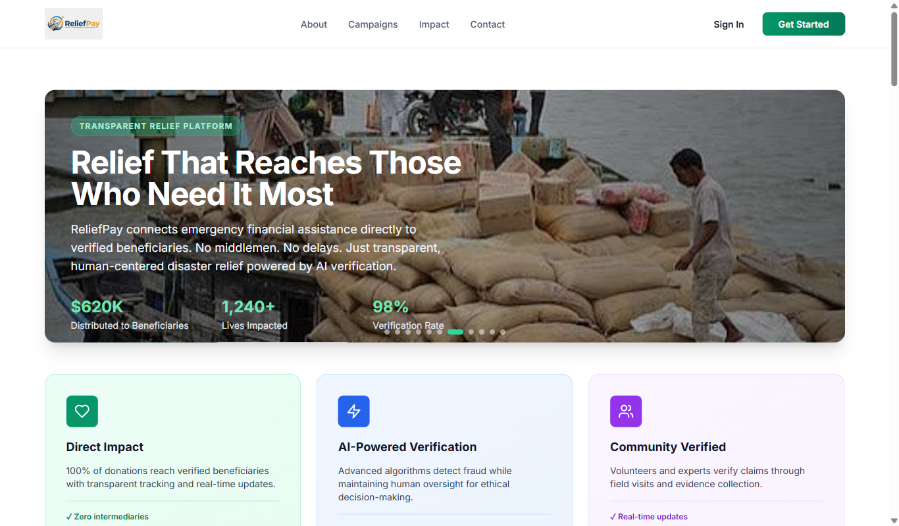
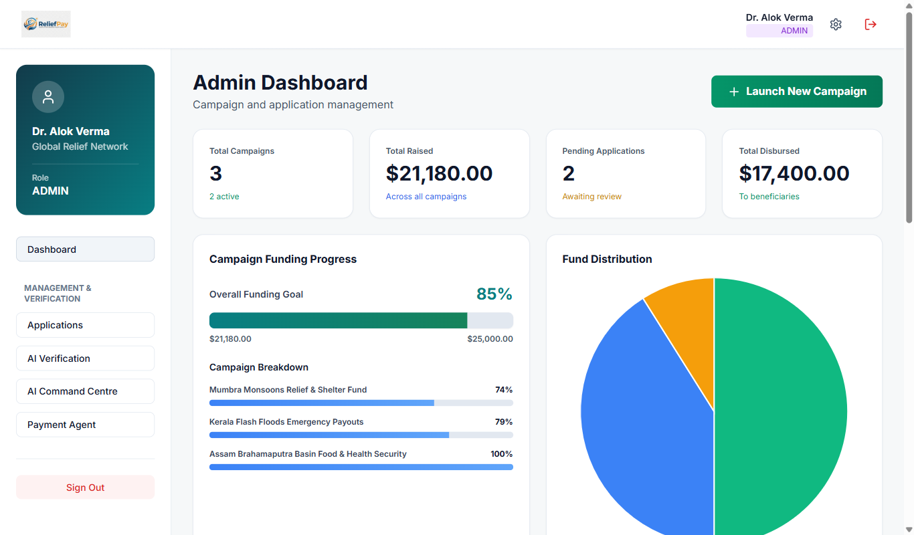
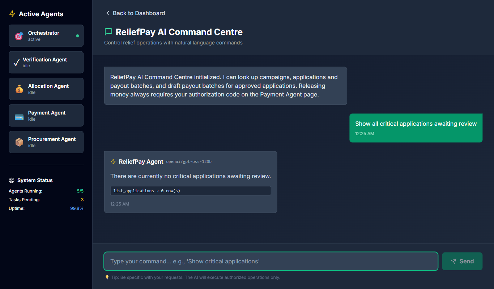
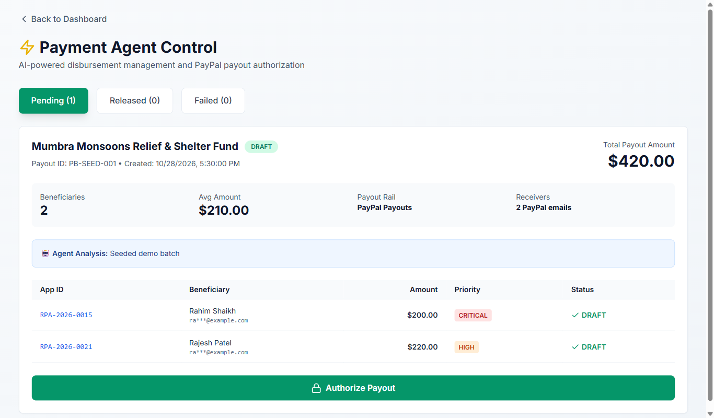
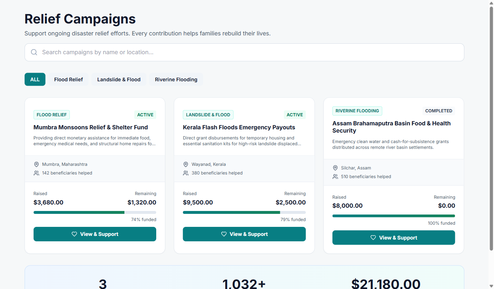
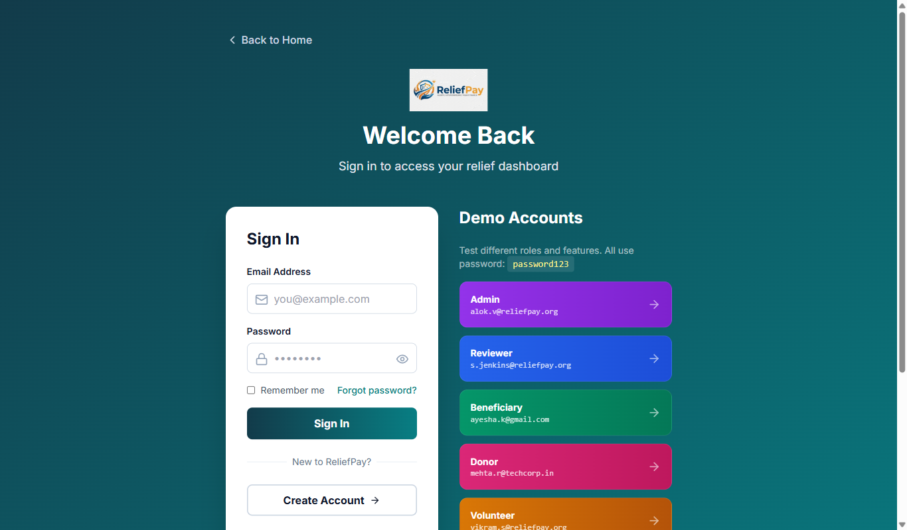

# ReliefPay Agentic Finance

ReliefPay is a disaster-relief platform where donors fund campaigns through PayPal Checkout and administrators pay approved beneficiaries through PayPal Payouts. A Groq-powered AI agent reads the live case and funding data and drafts payout batches, but only a human admin with a server-side authorization code can release money.

## Features

- **Donations with PayPal Checkout.** Logged-in users donate to a campaign with the PayPal JS SDK Buttons. The API creates and captures a PayPal Orders v2 order, and the campaign progress bar updates from the captured amount.
- **Admin-authorized PayPal Payouts.** Payout batches for approved applications are released with PayPal Payouts v1 only after an admin enters the payout authorization code. Status is refreshed from PayPal by webhook or by the "Refresh status from PayPal" button.
- **Signature-verified webhooks.** `POST /api/webhooks/paypal` verifies every event with PayPal's verify-webhook-signature API before it updates donations or payouts, and ignores duplicates.
- **Audit log.** Every state change (logins, donations, application decisions, AI chats and tool calls, payout drafts, releases, failed authorization attempts, webhook updates) is written to an audit log that auditors can read.
- **AI agent on Groq.** In the AI Command Centre an admin chats with an agent that calls local tools to read campaigns, applications, donations and payout batches, and can draft a payout batch. It has no tool that releases money.
- **Role-based access for 6 roles:** Admin, Reviewer, Beneficiary, Donor, Volunteer, Auditor.

Wired to the API: login/signup, campaigns and donations, the admin dashboard totals and charts, AI Command Centre, Payment Agent, application management, and the auditor dashboard and audit log. The donor dashboard mixes API data with sample data. Still showing mock data: the beneficiary and volunteer dashboards, AI verification, beneficiary registration and emergency application, and the map.

## Screenshots

Captured with Playwright against a local run (`npm run build` then `npm start --prefix backend`) using PayPal sandbox and Groq credentials.

| Landing page | Admin dashboard |
|---|---|
|  |  |
| **AI Command Centre (live Groq tool call)** | **Payment Agent (draft batch awaiting authorization)** |
|  |  |
| **Campaigns (USD, from the API)** | **Login with demo accounts** |
|  |  |

## Architecture

```
                        +-------------------------------+
  Browser               |  Express 5 API (backend/)     |
 +-----------------+    |  port 4000                    |      +------------------------------+
 | React 18 SPA    |--->|  /api/*  JWT auth + roles     |----->| PayPal REST (sandbox)        |
 | (Vite, dist/)   |    |  serves dist/ in production   |      |  Orders v2  create/capture   |
 | PayPal JS SDK   |    |                               |      |  Payouts v1 create/show      |
 +-----------------+    |  node:sqlite  -> reliefpay.db |      |  Webhooks   verify signature |
                        |                               |      +------------------------------+
                        |  AI agent (src/ai)            |               |
                        |   tools read DB, draft batch  |----->  Groq chat completions
                        +-------------------------------+        (OpenAI-compatible)
                                       ^
                                       |  PayPal -> POST /api/webhooks/paypal
```

Money flow:

1. A donor clicks the PayPal button. The API creates an order (`POST /api/donations/orders`), the donor approves it in the PayPal popup, and the API captures it (`POST /api/donations/orders/:orderId/capture`). The captured amount is added to the campaign.
2. Reviewers and admins approve applications with an approved amount.
3. An admin, or the AI agent on the admin's behalf, drafts a payout batch of approved applications. The API checks that the campaign has enough unreserved funds.
4. The admin releases the batch in the Payment Agent page with the authorization code. The API calls PayPal Payouts and records the PayPal batch id.
5. PayPal webhooks (or a manual sync) update batch and item status, and the audit log records each step.

All money is stored as integer cents in USD.

## Run it locally (for judges)

Prerequisites:

- Node.js 22.13 or newer (the API uses the built-in `node:sqlite` module).
- A free PayPal developer account with a sandbox REST app (see [PayPal sandbox setup](#paypal-sandbox-setup)).
- A free Groq API key from https://console.groq.com.

Install and configure:

```bash
npm ci
npm ci --prefix backend

# Windows
copy backend\.env.example backend\.env
# macOS / Linux
cp backend/.env.example backend/.env
```

Edit `backend/.env` and fill at least `PAYPAL_CLIENT_ID`, `PAYPAL_CLIENT_SECRET`, `PAYOUT_AUTH_CODE` and `GROQ_API_KEY`. The app still starts with missing values; the affected feature shows a "not configured" message.

Development mode (two terminals):

```bash
npm run dev --prefix backend   # API on http://localhost:4000 (restarts on change)
npm run dev                    # Vite on http://localhost:5173, proxies /api to port 4000
```

Open http://localhost:5173.

Production-style single process (one URL, the API serves the built SPA):

```bash
npm run build
npm start --prefix backend
```

Open http://localhost:4000.

Other commands:

```bash
npm test --prefix backend         # backend tests (PayPal and Groq are faked, no network)
npm run seed:reset --prefix backend   # delete the SQLite database and re-seed demo data
```

The database is created and seeded on first start at `backend/data/reliefpay.db`.

## Demo accounts

All accounts use the password `password123`.

| Role        | Email                    |
|-------------|--------------------------|
| Admin       | alok.v@reliefpay.org     |
| Reviewer    | s.jenkins@reliefpay.org  |
| Beneficiary | ayesha.k@gmail.com       |
| Donor       | mehta.r@techcorp.in      |
| Volunteer   | vikram.s@reliefpay.org   |
| Auditor     | elena@auditcore.org      |

## Environment variables

Backend (`backend/.env`, see `backend/.env.example`):

| Name | Required? | Purpose |
|------|-----------|---------|
| `PORT` | No (4000) | Port the API listens on. |
| `JWT_SECRET` | In production | Signs login tokens. Without it a random secret is used and logins reset on restart. |
| `DATABASE_PATH` | No | SQLite file path. Default `backend/data/reliefpay.db`. |
| `PAYPAL_CLIENT_ID` | For PayPal | Sandbox REST app client id. Also sent to the browser to load the PayPal JS SDK. |
| `PAYPAL_CLIENT_SECRET` | For PayPal | Sandbox REST app secret. Stays on the server. |
| `PAYPAL_API_BASE` | No | PayPal REST base URL. Default `https://api-m.sandbox.paypal.com`. |
| `PAYPAL_WEBHOOK_ID` | For webhooks | Id of the webhook created in the PayPal dashboard, used to verify signatures. |
| `PAYPAL_CURRENCY` | No (USD) | Currency for donations and payouts. |
| `PAYOUT_AUTH_CODE` | For payouts | Code an admin must enter to release a payout batch. |
| `PAYOUT_RECEIVER_EMAIL` | No | Sends every payout item to this sandbox personal account instead of the seeded example addresses. |
| `GROQ_API_KEY` | For the AI agent | Groq API key. |
| `GROQ_BASE_URL` | No | Default `https://api.groq.com/openai/v1`. |
| `GROQ_MODEL` | No | Default `openai/gpt-oss-120b`. |

Frontend (`.env` at the repo root, see `.env.example`): `VITE_API_URL` stays empty when the API serves the SPA or when you use the Vite dev proxy. Set it only if the frontend is hosted separately from the API.

## PayPal sandbox setup

1. Sign in at https://developer.paypal.com, open **Apps & Credentials** (Sandbox) and create an app. Copy its client id and secret into `PAYPAL_CLIENT_ID` and `PAYPAL_CLIENT_SECRET`.
2. Under **Sandbox accounts** you get a business account and a personal account. The business account (the app owner) receives donations and funds the payouts. Use the personal account to pay donations in the PayPal popup, and put its email in `PAYOUT_RECEIVER_EMAIL` so payouts land in an account you can open.
3. Webhooks (needed only for a public deployment): in the app, add a webhook with URL `https://<your-host>/api/webhooks/paypal` subscribed to `PAYMENT.CAPTURE.COMPLETED`, `PAYMENT.CAPTURE.DENIED`, `PAYMENT.PAYOUTSBATCH.*` and `PAYMENT.PAYOUTS-ITEM.*`. Copy the webhook id into `PAYPAL_WEBHOOK_ID`.
4. Local runs have no public URL for webhooks. After releasing a batch, click **Refresh status from PayPal** in the Payment Agent page; it calls `POST /api/payouts/:id/sync`, which reads the batch from PayPal.

## Deploy to Render

The repo includes `render.yaml`, a Blueprint with one free web service that builds the SPA and runs the API.

1. In the Render dashboard choose **New > Blueprint** and pick this repository.
2. Fill in the variables marked `sync: false`: `PAYPAL_CLIENT_ID`, `PAYPAL_CLIENT_SECRET`, `PAYPAL_WEBHOOK_ID`, `PAYOUT_AUTH_CODE`, `PAYOUT_RECEIVER_EMAIL`, `GROQ_API_KEY`. `JWT_SECRET` is generated by Render.
3. After the first deploy, create the PayPal webhook for `https://<service>.onrender.com/api/webhooks/paypal` and set `PAYPAL_WEBHOOK_ID`.

Free instances sleep when idle, so the first request after a pause is slow. The SQLite file lives on the instance's disk and is reset on every redeploy or restart, then re-seeded with the demo data.

## Tools used

- **PayPal JS SDK v5 Buttons**: the donate buttons on the campaign page.
- **PayPal Orders v2**: create and capture donation orders from the API.
- **PayPal Payouts v1**: create payout batches and read batch status.
- **PayPal Webhooks**: `verify-webhook-signature` for every incoming event.
- **Groq**: OpenAI-compatible chat completions with tool calling, default model `openai/gpt-oss-120b`. The tools run locally in the API (`backend/src/ai/tools.js`): `get_campaigns`, `list_applications`, `list_donations`, `list_payout_batches` and `draft_payout_batch`. Every call is audited.
- **Render**: hosting through `render.yaml`.
- **Kiro** (AI coding assistant): used to plan, write and test the backend, the PayPal and Groq integrations, the frontend wiring and this documentation.

We evaluated the PayPal Agent Toolkit and did not use it. It has no Payouts tools, and our agent must only read our own database and draft batches, never move money itself.

## Safety design

- **Human in the loop.** The AI agent can draft a payout batch but has no release tool. Only an admin can release, in the Payment Agent page.
- **Server-side authorization code.** The release code is checked on the server with a constant-time comparison. After 5 wrong attempts the batch is locked, and every failed attempt is audited.
- **No secrets in the browser.** The PayPal client secret, Groq key and authorization code live only in the API environment. The browser receives only the PayPal client id.
- **Funds checks.** Drafting fails if the campaign does not have enough unreserved funds or an application is not approved.
- **No double payouts after a failed release.** If PayPal returns an error, the batch moves to `RELEASE_FAILED` and keeps its applications, so they cannot be drafted into a second batch. Retry the same batch: it is resent with the same `sender_batch_id`, which PayPal deduplicates. While an application sits in a batch, its approved amount cannot be changed.

## Known limitations

- **Refunds and reversals are recorded only.** `PAYMENT.CAPTURE.REFUNDED`/`REVERSED` webhooks and payout items that become `RETURNED` or `REVERSED` after `SUCCESS` are written to the audit log, but they do not lower the campaign's raised or disbursed totals.
- **A batch can get stuck in `RELEASING`.** If the API process stops after sending a batch to PayPal and before PayPal answers, the batch stays `RELEASING` and cannot be released or synced. Check the batch in the PayPal sandbox dashboard, then run `npm run seed:reset --prefix backend` to reset the demo data. On Render the database is re-seeded on every restart.

## Demo script (under 3 minutes)

| Time | Scene |
|------|-------|
| 0:00 | The problem: relief money is slow to reach people and hard to audit. |
| 0:20 | Log in as the donor, open a campaign, donate $25 with a sandbox PayPal account; the progress bar moves. |
| 0:50 | Log in as the admin, open the AI Command Centre, ask for approved applications, then ask the agent to draft a payout batch. |
| 1:30 | Open Payment Agent, enter a wrong code first (rejected), then the right code to release the batch to PayPal Payouts. |
| 2:10 | Click "Refresh status from PayPal" (or show the webhook update) to see the batch status. |
| 2:30 | Log in as the auditor and show the full audit trail: donation, AI chat and tool calls, draft, failed code, release. |
| 2:50 | Close: PayPal moves the money, AI does the paperwork, a human approves. |

## License

MIT. See [LICENSE](LICENSE).
